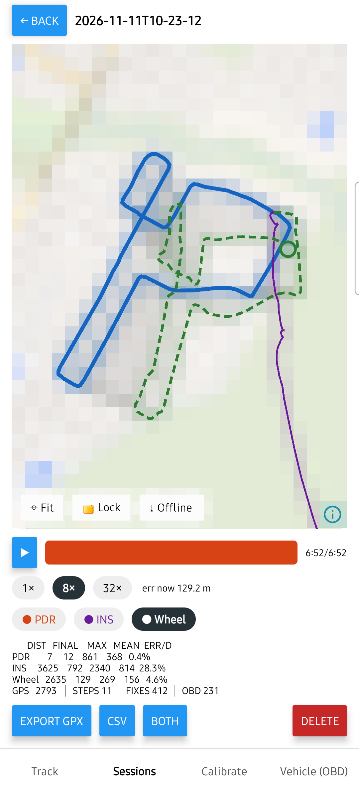
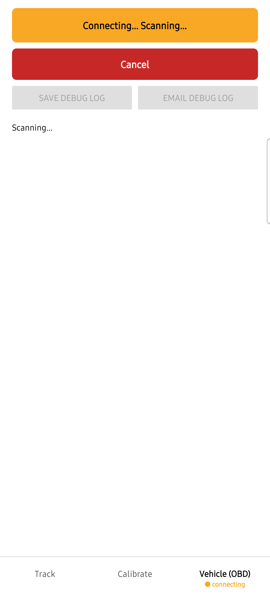

# Innova 3210RS Reader: GPS-free vehicle positioning on Android

A React Native Android app that estimates where a car is **without GPS**. It reads wheel speed from the car over a Bluetooth OBD-II dongle (Innova 3210RS) and combines it with the phone's IMU. It shows the estimate next to GPS on an offline map, and replays every drive to measure the error.

<table>
<tr>
<td width="50%"></td>
<td width="50%"></td>
</tr>
<tr>
<td>A real 2.8 km drive replayed. The green Wheel estimate tracks the blue GPS path to 4.6 % final error.</td>
<td>The in-vehicle hardware link: a persistent BLE session with visible states and auto-reconnect.</td>
</tr>
</table>

## Overview

Positioning without GPS has to hold up in a real car: offline, on phone-grade sensors, and over a Bluetooth link to in-vehicle hardware that can drop at any time. A phone IMU on its own drifts by kilometres, so the only real test of an estimate is to drive with the app running and compare it against GPS.

The app covers the whole path from the car to the map. It talks to the dongle over BLE (ELM327 commands), captures native sensor data, and runs three position engines: step-based PDR, strapdown INS, and Wheel (OBD speed plus a learned heading axis). It draws an offline MapLibre map and replays any session with GPX/CSV export. It was built in small milestones, each one checked on the phone before the next started. AI coding agents wrote much of the code; the direction, review, and judging of results against real drives were done by hand.

Testing is built around **manual driving tests** and **live recorded car data**. From the map milestone onward, each milestone ended with a driving test plan run by hand. Every drive was recorded (100 Hz IMU, 1 Hz GPS, OBD speed), scrubbed of private data, committed, and replayed through the app's own code as test fixtures. The drives found the bugs that mattered, and none of the unit tests had caught them:
- The OBD connection silently died after ~4 minutes; the drive log showed the dongle dropping the link. OBD now runs as a shared session with reconnect and visible state.
- The map jumped on every GPS fix. It now recenters only near the edge and can be locked.
- PDR counted 115 false steps in the car, which made an existing test fail on the new drive data. Steps are now ignored while OBD shows the car moving.

Each finding became a fix plus a regression test.

On a real 2.79 km drive, Wheel finished at **4.6 % error** (mean 156 m), against 28 % for INS. OBD speed matched GPS to within 0.3 %, and live and replayed results agreed to under 1 m. The drive data also points to the next fix: a fixed ~19° heading offset caused by freezing the learned axis too early. There are 51 unit tests, many of them built on the recorded drives.

## Documents

- [Install and Run](docs/INSTALL_AND_RUN.md): PC and phone setup, dev build or standalone APK, how to run a tracked drive, tests, and pulling data off the phone.
- [Test Overview](docs/TEST_OVERVIEW.md): issues found by manual driving tests, results from the recorded drives and engine accuracy, and a unit test summary.
- [App Evolution](docs/EVOLUTION.md): screenshots of the app growing from checking raw OBD and sensor input to the three-engine comparison, and how manual driving tests and live feedback reshaped each stage.
- [How Data Is Pulled](docs/HOW_DATA_IS_PULLED.md): how the app talks to the dongle (BLE, ELM327 commands, PIDs).
- [App Plan](docs/OBD_APP_PLAN.md): goals, architecture, milestones, and risks.
- [Test data](test/README.md): live car data recorded on real drives (IMU, GPS, OBD logs), its format, and the scripts that remove private data before committing.
